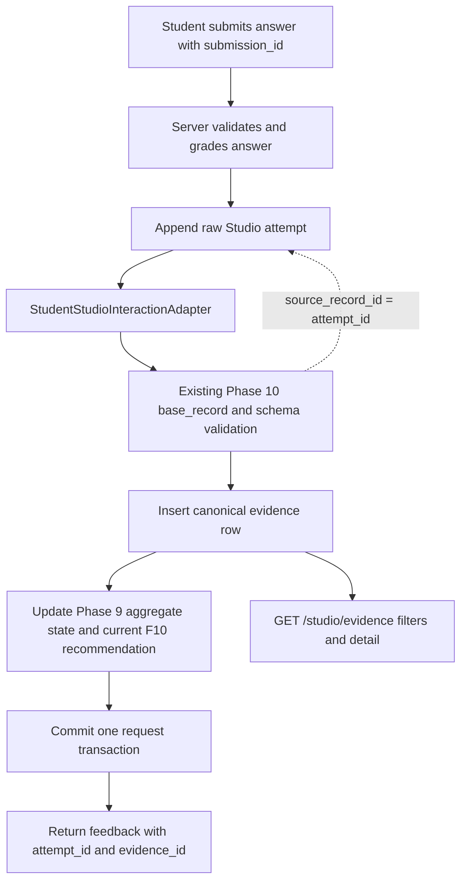

# F10.1 — Learning Evidence Integration Foundation

**Status: COMPLETE_AND_VERIFIED**  
**Scope:** Persist a separate, traceable Phase 10 evidence record for each successfully persisted Student Studio answer. This phase does not connect Studio answers to cognitive estimates, representation delivery, or trajectories.

## 1. Previous architecture and gap

F9 already used the Phase 10 `base_record()` normalizer and canonical `evidence_record_v1.schema.json`. It stored that record as JSON inside `studio_learning_attempts.evidence_record`; `GET /studio/evidence` read the embedded JSON. Answer submission, evidence normalization, Phase 9 aggregation, and the then-current recommendation were executed before one SQLAlchemy commit, so an exception rolled back the answer.

The gap was persistence architecture: a learning attempt and its derived evidence were not separate records. There was no evidence table with an event relationship, uniqueness rule, topic index, or record-level lookup. The F9 evidence endpoint was profile-wide and could not filter by topic or lesson.

## 2. Integration design

The new `StudentStudioInteractionAdapter` converts the already server-graded answer event to the existing Phase 10 schema. It does not introduce a new evidence schema or update the historical EdNet artifact index. A new `studio_evidence_records` table stores the canonical JSON record separately from the raw attempt. It has a foreign key to the source attempt, a learner/profile foreign key, and a unique `(profile_id, source_event_id)` constraint.

All writes remain inside the existing answer request transaction. The attempt row is flushed before evidence insertion so its foreign key can be checked; evidence creation occurs only after grading and attempt flush succeed. If evidence insertion, validation, or later processing fails, the route does not commit and request-session cleanup rolls back the attempt, evidence, state version, and recommendation together.

## 3. Files changed

### New

- `src/mcp_ri/evidence/adapters/student_studio.py` — dedicated adapter using the existing canonical evidence normalizer.
- `migrations/versions/0004_f10_1_learning_evidence.py` — additive evidence table, indexes, valid F9 evidence backfill, and downgrade restoration.
- `tests/api/test_learning_evidence_persistence.py` — isolated SQLite tests for persistence, retry, rejected answers, rollback, and migration preservation.
- `docs/F10_1_LEARNING_EVIDENCE_FOUNDATION.md` — this implementation record.

### Updated

- `src/mcp_ri/api/persistence.py` — separate evidence model, latest schema contract, and nullable legacy inline field.
- `src/mcp_ri/api/learning_service.py` — adapter integration, atomic evidence persistence, canonical-table retrieval and filtering.
- `src/mcp_ri/api/learning_routes.py` — learner/topic/lesson filters and evidence detail route.
- `src/mcp_ri/evidence/adapters/__init__.py` — exports the adapter.
- `shared/api-contracts/openapi.json` — regenerated from current FastAPI routes.
- `frontend/components/studio/student-studio-client.tsx` — after successful submission, shows that the evidence record was saved and its identifier.
- `tests/api/test_learning_api.py`, `tests/api/test_learning_foundation.py`, `tests/api/test_learning_intelligence.py` — focused assertions and migration expectations.

The checkout already had uncommitted changes in `learning_routes.py`, `learning_service.py`, `test_api.py`, `test_learning_foundation.py`, and untracked `test_learning_intelligence.py` before F10.1 began. Those changes were inspected and preserved; F10.1 extends the current routes/service and the named tests, while `test_api.py` was left untouched. The pre-existing audit reports under `docs/audit/` were not rewritten.

## 4. Learning event to evidence data flow

1. The browser sends a stable `submission_id`, session and response to `POST /api/v1/studio/questions/{question_id}/answer`.
2. The service validates the session and question, grades the answer, and creates a raw append-only attempt with its server timestamp and profile event sequence.
3. After the attempt flush, `StudentStudioInteractionAdapter.from_answer_event()` calls the existing Phase 10 `base_record()` and evidence validator.
4. The normalized record is inserted into `studio_evidence_records`, linked to the attempt. The Phase 9 aggregate update and current F10 state/recommendation work follow within the same request transaction.
5. After commit, feedback returns the attempt and evidence IDs. The student practice view displays the evidence ID.
6. Evidence list/detail endpoints query the separate evidence table. The research evidence endpoints continue reading the EdNet/Phase 10 artifact index and remain unchanged.

The raw response remains on `studio_learning_attempts.submitted_response`; new attempts set the old `evidence_record` field to `NULL`. Existing F9 rows retain their original embedded evidence copy. Migration 0004 copies schema-consistent records into the separate table without deleting or rewriting the source attempts. The legacy field remains nullable for compatibility and safe downgrade.

## 5. Schema, versions, and provenance

The evidence record uses the repository's existing schema:

- `schema_version`: `1.0` (`schemas/evidence_record_v1.schema.json`).
- `provenance.processing_version`: `mcp-ri-evidence-1.0.0` from `src/mcp_ri/evidence/normalizer.py`.
- `provenance.source_dataset`: `mcp-ri-student-studio`.
- `provenance.source_record_id`: the persisted attempt ID; this is the source event identifier.
- `learner_id`: `studio-local-demo`, kept out of EdNet learner records.
- `content`: subject, course, topic, lesson, question, answer-submission interaction type, submitted answer, server grading outcome, content version, and empty `skill_ids`.
- `temporal.event_timestamp`: server answer-submission time. `temporal.ingestion_timestamp` and `processing.processing_timestamp` record evidence creation/processing time.
- `studio_evidence_records`: links canonical evidence ID to `source_event_id`, profile, topic, lesson, and question.

No numeric score is added because the existing questions return a binary correctness result and define no points. No cognitive label, misconception, skill mapping, or mastery outcome is synthesized.

## 6. Idempotency

The existing client `submission_id` remains unique per demo profile in `studio_learning_attempts`. An exact retry returns the existing attempt feedback and evidence ID without writing a second attempt or evidence row. Reusing the key with a different answer/question/session remains a conflict. The evidence table additionally enforces unique `(profile_id, source_event_id)` and primary-key `evidence_id`, so repeated processing of the same persisted event cannot create a second evidence row.

The source event ID is the attempt ID; the normalized evidence ID is stable from the canonical normalizer inputs, including that source record ID. A browser reload that creates a new submission ID is a new attempt by current F9 semantics; the local profile is not an authenticated user identity.

## 7. Transaction and recovery behavior

Attempt, evidence, state-version, and current recommendation inserts occur in one SQLAlchemy transaction. The route's existing process-local `RLock` still serializes SQLite sequence allocation and commit for the singleton demo profile. Database unique constraints remain authoritative across processes. A failed evidence write prevents commit; focused rollback testing confirms no attempt or evidence row remains.

Migration 0004 is additive. It backfills valid legacy F9 evidence records only when learner, source attempt, topic, and lesson references match. It keeps original attempt rows and payloads. Invalid legacy payloads are left untouched in their original attempt and are not reinterpreted. On downgrade, evidence is copied back into a null legacy attempt field before dropping the derived table, then the column is restored as non-null.

No configured/local application database was migrated in this phase. Migration and downgrade tests use temporary SQLite databases.

## 8. API changes

Existing conventions and success/error envelopes are retained:

- `GET /api/v1/studio/evidence?learner_id=studio-local-demo&topic_id=...&lesson_id=...&limit=...&offset=...` — paginated canonical evidence; filters are optional. Unknown learner returns 404; malformed identifiers return 422; an unmatched valid topic/lesson yields an empty page.
- `GET /api/v1/studio/evidence/{evidence_id}?learner_id=...` — returns one canonical record; a missing or out-of-scope record returns 404.
- Existing `GET /api/v1/{learners/{learner_id}/evidence...}` research endpoints are unchanged and continue serving indexed research evidence.

Studio evidence remains explicitly source-separated; it is not inserted into `ArtifactRecord`, EdNet JSONL files, model inputs, or historical evaluation metrics.

## 9. Frontend changes

Only the practice feedback message changed: once the answer API returns successfully, it shows “evidence recorded” and the canonical evidence ID. It makes no cognitive or mastery claim. The existing research evidence explorer was not broadened to silently mix demo-profile events into EdNet learner records. No recommendation interface was added.

## 10. Initial test and verification results

Passed:

- `PYTHONPATH=src .venv-api/bin/python -m pytest tests/api/test_learning_evidence_persistence.py -q` — **4 passed**. Covers actual service answer/evidence writes in temporary SQLite, stable retry, canonical retrieval/filter, data after database reopen, rejected answer/no evidence, rollback when evidence persistence fails, `0003 → 0004` historical backfill, source-attempt preservation, and downgrade restoration.
- `PYTHONPATH=src .venv-api/bin/python scripts/api/export_openapi.py` — generated contract successfully.
- `python3 -m compileall -q src/mcp_ri/api src/mcp_ri/evidence/adapters tests/api` — Python compilation passed.
- Frontend `npm run lint`, `npm run test:api`, and `npx tsc --noEmit` — passed; API test script reports **8 passed**.
- `git diff --check` — passed.

At the time of the initial implementation pass, the complete API suite had not been verified. The closure below supersedes that initial status.

- Browser/API runtime was not started, and no configured application DB was touched. Migration behavior was exercised against disposable SQLite files.
- Production frontend build was not rerun; the prior audit recorded the existing Next.js `--showConfig` parsing failure. Direct TypeScript, lint and frontend tests pass after the small UI change.

## Verification closure (2026-11-16)

### Original failure and root cause

The original bounded API test command stalled in `TestClient.__enter__`. The stall reproduces with a bare `FastAPI()` app, without this application's lifespan, database, fixtures, or migrations. A direct ASGI lifespan handshake succeeds. An isolated AnyIO blocking portal also stalls: its worker thread queues the event-loop wake callback, but the socketpair wakeup raises `PermissionError: [Errno 1] Operation not permitted` under the sandbox's seccomp policy. This identifies the cause as sandbox socket-wakeup restriction during TestClient's cross-thread event-loop startup. It is not a FastAPI/Starlette/httpx dependency incompatibility, app lifespan deadlock, SQLite/database lock, migration hang, or fixture teardown failure.

The test suite was run outside that sandbox restriction using a bounded 120-second command. The API fixtures and migration tests use per-test `tmp_path` SQLite databases. No dependency was installed or upgraded, and no configured application database was modified.

### Corrective action and test findings

No application workaround for the sandbox restriction was needed. The first unrestricted suite run exposed three genuine test issues: the OpenAPI schema test still expected migration 0003 instead of 0004; retry feedback did not refresh the mutated JSON field because SQLAlchemy considered the reassigned shallow-copied value unchanged; and a state-history test deleted rows before deleting their referencing recommendation. These were corrected by updating the schema expectation, explicitly marking retry feedback modified, and clearing the dependent recommendation before state history. Migration coverage was extended to verify re-upgrade after downgrade.

### Executed checks and exact results

- `PYTHONPATH=src .venv-api/bin/python -m pytest tests/api -q` (outside sandbox, 120-second timeout) — **42 passed in 27.08s**.
- `PYTHONPATH=src .venv-api/bin/python -m pytest tests/api/test_learning_evidence_persistence.py -q` — **4 passed in 2.04s**.
- Focused HTTP/API coverage includes successful attempt and evidence creation, transaction rollback on failed evidence write, duplicate submission retry, rejected answers, evidence list/detail retrieval, source-attempt linkage, and Student Studio/EdNet separation.
- Disposable SQLite migration verification covers 0003 → 0004, legacy evidence backfill, source-attempt preservation and evidence references, downgrade restoration, and re-upgrade. No configured database was used.
- `python3 -m compileall -q src scripts migrations tests` — passed.
- Frontend `npm run lint && npm run test:api && npx tsc --noEmit` — passed; frontend API test script reports **8 passed, 0 failed**.
- `PYTHONPATH=src .venv-api/bin/python scripts/api/export_openapi.py` — passed and regenerated the OpenAPI contract.
- `git diff --check` — passed.

### Remaining limitations and acceptance decision

TestClient remains unusable inside the restricted sandbox due to the socket wakeup policy; the complete suite is verified with the bounded outside-sandbox execution. The production frontend build was not rerun; the prior audit documented its existing Next.js `--showConfig` parsing failure. No configured application database was migrated or otherwise changed. F10.1 does not add cognitive-state integration, representation planning, or recommendation functionality.

**Final F10.1 status: COMPLETE_AND_VERIFIED.** All F10.1 acceptance criteria and the requested backend, migration, frontend, OpenAPI, compilation, and diff checks passed.

- `PYTHONPATH=src .venv-api/bin/python -m pytest tests/api -q` does not complete in the available virtualenv. Even the first existing API test hangs inside `starlette.testclient.TestClient.__enter__` while starting the test app; the app's lifespan context enters/exits normally when invoked directly. Installed versions are FastAPI 0.162.4, Starlette 1.10.0, and httpx2 2.16.0. The new route-level API tests therefore could not be reported as passing in this environment.
- Browser/API runtime was not started, and no configured application DB was touched. Migration behavior was exercised against disposable SQLite files.
- Production frontend build was not rerun; the prior audit recorded the existing Next.js `--showConfig` parsing failure. Direct TypeScript, lint and frontend tests pass after the small UI change.

## 11. Known limitations

- The Student Studio identity remains one fixed unauthenticated local demo profile; profile scoping is not multi-user authorization.
- The lock is process-local. Multiple worker processes could contend for per-profile event sequencing; unique constraints prevent duplicate keys but no retry/sequence allocator is added here.
- The TestClient runtime integration suite requires execution outside the sandbox because sandbox policy denies the event-loop socket wakeup; the complete suite passed there with a bounded timeout.
- Malformed historical F9 evidence is retained in its source attempt but skipped by the migration backfill; it is not exposed as a canonical evidence row.
- Studio topics have no validated EdNet skill mapping. `skill_ids` remains empty; no Phase 11/12/13 integration or recommendation UI is part of F10.1.

## 12. Remaining F10.2 work

At F10.1 closure, the aggregate behavioral-state integration still required separate review. That follow-up is now documented and verified in [`F10_2_STUDENT_STUDIO_BEHAVIORAL_STATE.md`](F10_2_STUDENT_STUDIO_BEHAVIORAL_STATE.md). Studio cognitive estimation, representation delivery, and trajectory adaptation remain later work because their concept grounding and executable capability prerequisites are not established.

## Acceptance assessment

| Criterion | Result |
|---|---|
| Successfully persisted answer creates evidence | Implemented and verified by focused API and full API suites. |
| Evidence has traceable provenance | Implemented and verified by source-attempt linkage checks. |
| Duplicate processing does not duplicate evidence | Implemented with stable attempt retry and DB constraints; verified. |
| Evidence persists and legacy evidence remains available | Temporary DB reopen and migration backfill/downgrade/re-upgrade verified. |
| Learner/source separation | Separate table/profile/source verified; EdNet artifacts are not mutated. |
| F9 grading/progress and frontend regressions | Backend API and frontend lint/type/tests pass. |
| Relevant backend and frontend tests pass | Full API suite: 42 passed; focused persistence: 4 passed; frontend API tests: 8 passed. |
| Implementation documented | Complete. |

**Overall F10.1 acceptance: COMPLETE_AND_VERIFIED.** See the verification closure above for the sandbox-specific test execution detail.
