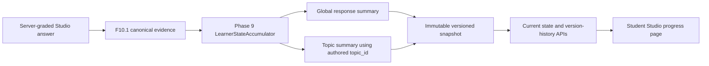

# F10.2 — Student Behavioral Learner-State Integration

**Status: COMPLETE_AND_VERIFIED**

**Scope:** Derive inspectable behavioral summaries by authored Student Studio topic from persisted F10.1 evidence, preserve version history, expose the summaries through the Student Studio API and progress page. This is response-history reporting, not cognitive diagnosis, mastery estimation, recommendation, or adaptive instruction.

## Phase 9 reuse analysis

Phase 9's `LearnerStateAccumulator` is the reusable online estimator. It provides observed attempt/correct/incorrect counts, recent and historical accuracy, a Beta(1,1) smoothed response estimate, Wilson 95% intervals, heuristic evidence tiers, and the latest-five-versus-preceding-five trend. The methodology is described in `docs/LEARNER_STATE_METHODOLOGY.md`; its EdNet evaluation report is `results/reports/phase9-learner-state-20261106T081823Z/evaluation.json`.

The calculations and accumulator are reused directly. The EdNet `skill_ids()` parser and skill ontology are not reused for Studio: F10.1 evidence intentionally carries `skill_ids: []`, and there is no validated topic-to-EdNet-skill mapping. The existing event bridge now also carries the evidence's authored `content.topic_id` into an additional topic accumulator. Topic IDs remain curriculum aggregation labels; they do not imply skill equivalence, prerequisites, or cognitive concepts. EdNet schema `learner_state_v1` remains unchanged. Studio adds a versioned wrapper extension (`student_studio_state_schema_version: "1.0"`) to its persisted state JSON.

## Architecture and source of truth

`studio_evidence_records` remains the source of truth for canonical answer evidence. `studio_behavioral_state_versions` stores immutable derived snapshots and provenance pointers. Each accepted answer is already written with its F10.1 evidence and F9-derived state version in the same request transaction. Version number and event sequence follow the persisted Studio event sequence, not event timestamp sorting. The evidence timestamp is retained on each observation; if events arrive with non-monotonic timestamps, the persisted event sequence remains the deterministic processing order and snapshots do not reorder prior events.

The state can be reconstructed by replaying attempts in `event_sequence` order and validating each source evidence record. `_ensure_state_versions()` appends missing versions transactionally, verifies already-stored event/evidence/version links, and does not append a second version for a retried submission. Previously persisted F10 snapshots without the Studio topic extension are returned with a topic extension reconstructed from their evidence prefix; historical snapshot rows are not overwritten.

## State fields and calculation

Each topic summary includes the authored `topic_id` (`concept_id` field name retained from the Phase 9 metric shape), total labeled attempts, correct and incorrect responses, historical accuracy, recent accuracy over up to five responses, Beta(1,1) smoothed response performance, Wilson 95% interval, evidence sufficiency/confidence/uncertainty, trend and change, last observed question/timestamp, and evidence count. Correctness is derived only from the server-graded F10.1 record.

The reused Phase 9 rules are unchanged: insufficient evidence for trend below ten observations; trend compares the latest five with the preceding five and uses a 0.10 threshold; evidence is low below five attempts, moderate from five through nineteen, and high from twenty; Wilson width qualifies the confidence/uncertainty labels. These are descriptive heuristics, not calibrated understanding probabilities. No score, label, misconception, skill mapping, prerequisite, or mastery claim is added.

State versions reference the source event sequence, latest evidence ID, cumulative evidence count and previous version. API responses include all supporting evidence IDs valid through that version. Empty topics return an explicit `state: null` and empty history; no EdNet state is substituted.

## API changes

- `GET /api/v1/studio/behavioral-state` returns the current Studio state, including `topic_states`, profile, state version and supporting evidence IDs.
- `GET /api/v1/studio/behavioral-state/versions` returns paginated immutable snapshot history. Older snapshots are augmented in the response from their own evidence prefix if they predate the topic extension.
- `GET /api/v1/studio/behavioral-state/topics/{topic_id}` returns the current topic summary and newest-first snapshot history with the evidence IDs supporting each version. Unknown curriculum topic IDs return 404; known topics with no attempts return an explicit empty state.

All routes use the standard success envelope and `student_studio_interactions` source tag. They read Studio evidence/state tables, never the EdNet artifact index. The OpenAPI contract was regenerated.

## Frontend changes

The `/studio/progress` page now requests the persisted behavioral-state API and shows a topic-by-topic behavioral summary: attempt and outcome counts, historical and recent response accuracy, evidence tier, and trend availability. It labels these as descriptive summaries and says explicitly that they are not cognitive diagnoses or mastery scores. No evidence displays a transparent empty state asking the learner to submit practice.

The frontend service includes current and topic-history calls with typed response contracts. No cognitive, representation, trajectory, or recommendation interface was added.

## Verification

All tests use isolated temporary SQLite databases. No configured application DB was migrated or changed; no EdNet source, partition, or evaluation artifact was modified or read for learner-state integration.

- `PYTHONPATH=src .venv-api/bin/python -m pytest tests/api -q` — **51 passed**.
- `PYTHONPATH=src .venv-api/bin/python -m pytest tests/test_learner_state.py tests/api/test_learning_intelligence.py tests/api/test_learning_evidence_persistence.py -q` — **31 passed**.
- Focused assertions cover initial topic snapshot creation, state updates, retry idempotency, immutable history, valid evidence references, empty/unknown topics, replay reconstruction, and Studio/EdNet separation.
- Frontend `npm run lint`, `npm run test:api`, `npx tsc --noEmit` — passed; frontend API test runner reports **8 passed**.
- Python compileall, OpenAPI export and `git diff --check` — passed.
- Live smoke test: started the API with `MCP_RI_AUTO_MIGRATE=true` against a disposable `/tmp` SQLite database, served `/studio/progress` from Next.js, submitted a real answer over HTTP, then read the resulting topic state and confirmed its evidence reference. Both servers were stopped and the temporary database removed.

## Limitations and F10.3 dependencies

- Student Studio still uses the single unauthenticated `studio-local-demo` profile; this is not multi-user authorization.
- Topic is the finest supported aggregation level. Skill/concept mappings and prerequisites require curriculum evidence and validation before they may be introduced.
- Wilson and Beta estimates summarize recorded response correctness. The histories may contain dependent/repeated attempts; the estimates do not establish learning, mastery, or cognition.
- New evidence creates one global snapshot version; a topic's history includes versions where that topic had evidence. Timestamp irregularities do not reorder the append-only event sequence.
- F10.3 can add downstream intelligence only after it specifies supported mappings, validation data and claims boundaries. Cognitive-state estimation, representation planning, trajectory orchestration and adaptive recommendations are outside F10.2.

**Final F10.2 status: COMPLETE_AND_VERIFIED.**
