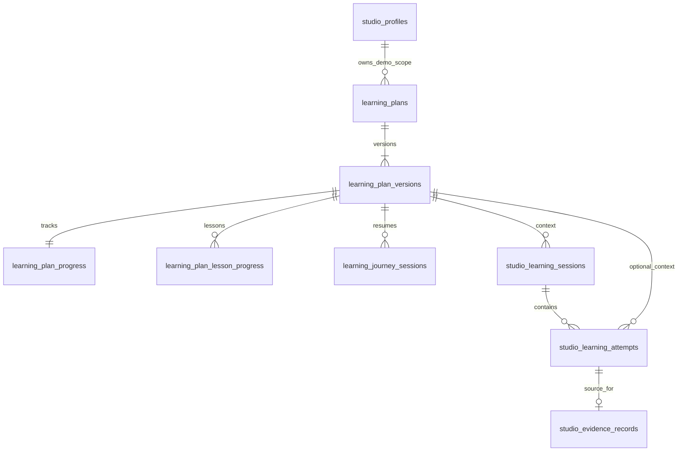

# 03 — Proposed learning-plan data model

**Design only.** No tables or migrations are created in this stage. Keep the current preview provider-independent and reuse existing attempts/evidence.

## Entities and relationships

### `learning_plans` — stable journey identity

- `plan_id` primary key; `profile_id` FK to `studio_profiles.profile_id` for the current demo phase; `goal` (normalized student text); `status`; `current_version_number`; `created_at`, `updated_at`, nullable `accepted_at`, `archived_at`; monotonic `revision`.
- Index `(profile_id, status, updated_at)` for learner-owned listing/resume. Enforce at most one active journey per profile only if product policy chooses that; do not silently hard-code it without validation.
- Keep current version pointer consistent with a composite FK or transactional service invariant. Do not reuse `learner_references`, whose namespace identifies research data.

### `learning_plan_versions` — immutable accepted plan snapshot

- Composite PK `(plan_id, version_number)` and FK to plan; `version_id` may be an additional opaque public ID with unique constraint.
- Fields: version number, goal snapshot, curriculum version/hash, ordered step snapshot (objective/topic/lesson IDs, title snapshots, order, activity/question references, prerequisite references only when authored/validated), assessment context, provenance/evidence version used for personalization, provider/rule-based source, `change_reason`, `created_at`, `accepted_at`, acceptance actor reference when auth exists.
- After acceptance, make content immutable at service level and preferably DB trigger only if supported and operationally tested. Corrections produce another version. Store exact item/content versions or immutable content references; the current curated curriculum is loaded from a single JSON file and has no catalog history table, so preserving a plan snapshot alone will not preserve the former lesson body. Content version retention/hash strategy is a prerequisite for reliable historical lesson inspection.

### `learning_plan_progress` — progress per accepted version

- Composite key/FK `(plan_id, version_number)`; progress status; current ordered step; current lesson and activity reference; last activity timestamp; completed objective IDs and completion summary (JSON initially, with schema/version); optimistic `revision`.
- Separate progress per version prevents a revised plan from rewriting history. Plan-level dashboard may project current-version progress.

### `learning_plan_lesson_progress` — plan-scoped lesson checkpoints

- Key `(plan_id, version_number, lesson_id, content_version)`; FK to plan version; profile ownership derivable through plan.
- Status, `current_section_id`, completed required section IDs, started/updated/completed timestamps, revision. The existing `studio_lesson_progress(profile_id, lesson_id)` remains unchanged and retains generic F9 history. A plan-scoped table is needed because existing PK cannot represent the same lesson under multiple plans/versions.

### `learning_journey_sessions` — resumable plan session

- `journey_session_id` primary key; plan/version FK; profile scope; associated existing `studio_session_id` nullable FK; current lesson/section/activity; status; start/last activity/end times; `client_request_id`/idempotency key; revision.
- It stores journey resume coordinates, not copied attempts. Existing Studio sessions continue to support tutor/activity context. If a plan-bound journey maps an existing session, constrain its version context and ensure old profile+lesson session reuse cannot silently attach the same active session to unrelated plans.

### Attempts/evidence association

- Prefer nullable `plan_id` and `plan_version_number` on `studio_learning_sessions` and `studio_learning_attempts`, with composite FK to version and a check that both are null or both are set. New legacy/unplanned Studio activity keeps NULL; old rows remain unchanged. Answer attempt still exists exactly once; canonical evidence stays in `studio_evidence_records` and remains linked to that attempt.
- SQLite needs Alembic batch table rebuild for FK/check changes. An alternative is a unique `learning_plan_attempt_links(attempt_id, plan_id, version_number)` relation; choose one after testing query/update semantics. Do not store a second attempt or evidence payload.
- A request's plan/version association must match the owned session, lesson and content version. On acceptance and answer commit, enforce this in one transaction. If association is optional for legacy flows, unplanned requests remain valid.

## Separation from current models

- `LearningPlanService.preview()` remains read-only and creates neither plan nor progress.
- `studio_lesson_progress` remains the generic, currently working per-profile lesson checkpoint. Plan-specific checkpoint rows add version scope rather than changing its PK or reinterpreting past rows.
- `studio_learning_attempts` and `studio_evidence_records` remain canonical answer/evidence history. New nullable context or link records associate them with journey versions.
- `trajectories` and `trajectory_versions` are a distinct research/application path construct. Do not reuse them as Student Studio plans or merge learner identity spaces.
- No data-model change is needed for unvalidated cognitive/knowledge assessment outputs; do not persist them as authoritative mastery.
